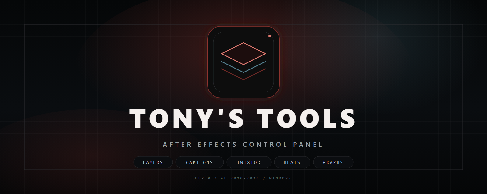

# Tony's Tools

A dockable **Adobe After Effects** panel for layer utilities, captions, Twixtor/flowframe preparation, beat markers, easing graphs and a global theme system. It is a CEP extension built from plain HTML/CSS/JavaScript and ExtendScript: no build step, no package manager and no runtime dependencies.



> **Target:** After Effects 2024 (24.x) on Windows. The CEP manifest accepts AE 2020-2026 and the CEP 9 runtime. The development install is unsigned; signed `.zxp` packaging is optional.

## What the panel does

1. Reads the active composition and shows layers, adjustment layers, nulls, precomps, text layers, effects, keyframes and the most-used effect.
2. Re-times every keyframe of the selected layers to the layer duration, or trims the layer in and out points to its first and last keyframe.
3. Auto pre-composes the selected layers with **Leave attributes**, **Move attributes** or **Adjust comp**.
4. Builds real AE text layers from `seconds | text` caption lines.
5. Prepares Twixtor-style flowframe clips, aligns clips to beat markers and fits clips between beats.
6. Generates beat markers from an audio amplitude layer, with marker names, colours and strength modes.
7. Applies cubic-bezier easing to keyframes through a draggable graph editor.
8. Applies a global accent colour, darkness level and theme preset.

Host operations run inside undo groups and act on the active composition and current selection. The panel does not change project settings, queue renders or make network requests.

## Project structure

```text
Tony-Tools/
├── CSXS/
│   └── manifest.xml              # CEP manifest (AEFT 17.0-99.9, CEP 9 runtime)
├── css/
│   └── styles.css                # dark neon theme
├── js/
│   ├── CSInterface.js            # minimal CEP bridge
│   └── main.js                   # panel logic and evalScript bridge
├── jsx/
│   └── host.jsx                  # ExtendScript host operations
├── assets/
│   ├── tony-tools-banner.png     # README banner (documentation only)
│   └── tony-tools-banner.svg     # editable banner source
├── index.html                    # five-tab panel UI
├── check.ps1                     # static consistency checks
├── package.ps1                   # zip and signed .zxp packager
├── README.md
├── LICENSE
├── .debug                        # remote debugging port 8092
├── .gitignore
├── dist/                         # generated archives (ignored by Git)
└── ref-*.{js,css,html}           # development reference dumps
```

`assets/` is documentation-only and is not included in release archives. `dist/` is created by the packager and ignored by Git.

## Requirements

- After Effects **2024 (24.x)** is the primary target. The manifest range `[17.0,99.9]` covers AE 2020-2026.
- **CEP 9 or newer** (ships with AE 2019 and later).
- **Windows 10 or 11.** The panel is not tested on macOS.
- **PowerShell 5.1 or newer** for `check.ps1` and `package.ps1`.
- Optional: Adobe's `ZXPSignCmd` and a PKCS#12 certificate for a signed `.zxp`.

There is no Node.js, npm, Python or build tool requirement for the panel itself.

## 1. Install the panel

### 1.1 Enable CEP debug mode (unsigned development install)

`PlayerDebugMode` is a **String value** set to `1` under each installed CEP runtime:

| CEP runtime | Registry key |
| --- | --- |
| CEP 11 | `HKEY_CURRENT_USER\Software\Adobe\CSXS.11` |
| CEP 10 | `HKEY_CURRENT_USER\Software\Adobe\CSXS.10` |
| CEP 9 | `HKEY_CURRENT_USER\Software\Adobe\CSXS.9` |

Only add the value for runtimes installed on the machine. This is a one-time, per-user setting.

### 1.2 Copy the extension

Copy or symlink the repository root into the CEP extensions directory:

```text
%APPDATA%\Adobe\CEP\extensions\Tony-Tools
```

The folder must contain `CSXS/manifest.xml` and `index.html` at its top level. Do not point CEP at a parent folder that only contains the project.

### 1.3 Restart and open the panel

Restart After Effects, then open **Window > Extensions > Tony's Tools**. With `PlayerDebugMode` enabled, the panel does not need a signature or a `.zxp`.

### 1.4 Signed installation

Build a signed package with `package.ps1 -Sign` (see [Packaging](#4-packaging)) and install it with Extension Manager or your usual ZXP installer. A valid signature is intended to load without `PlayerDebugMode`; some CEP versions treat a self-signed certificate as untrusted. If that happens, trust the certificate or use the development install instead.

## 2. Use the panel

### Panel controls

- **Reload Script** reloads the panel and refreshes the ExtendScript host.
- **CACHE** scans the disk cache folders of detected AE versions and clears selected cache items. Scanning can take a moment on large caches.
- **Settings** changes the global accent colour, darkness level and theme preset. Settings persist in `localStorage` and are restored when the panel reopens.
- Section buttons such as **Refresh** reload live values without changing the composition.

### Layers

#### Active comp stats

The **Active Comp** card reports layers, adjustment layers, nulls, precomps, text layers, effects, keyframes and the most-used effect. Values are read from `app.project` when the panel opens and when **Refresh** is pressed.

#### KF Assistant

- **Stretch KF → Layer** re-times every keyframe of the selected layers so the first key sits on the layer in point and the last on its out point. It does not change the layer duration or its `stretch` value. It walks nested property groups (effects, masks and shape contents), skips Time Remapping, keeps locked layers locked and carries over values, interpolation and temporal ease where AE allows it.
- **Trim Layer → KF** trims the selected layers' in and out points to their first and last keyframes.

Locked layers are handled safely; layers without enough keyframes are skipped.

#### Pre-Compose

Choose **Leave attributes**, **Move attributes** or **Adjust comp**, then click **Auto Pre-Compose**. The new precomp layer is found by its source comp id, not by a stale layer index, so existing precomp layers are not confused with the new one.

#### User presets

The panel scans the AE **User Presets** folder for `.ffx` presets. Use the search field to filter, click a preset to apply it to the selected layers, or choose a different presets folder with the folder button. Refresh the list after adding presets in AE.

#### Adj. Layer and Null Object

Both cards have a 1-20 stepper and a Create button. They create adjustment layers or null objects.

### Captions

Paste one caption per line in the form `seconds | text`:

```text
0.0 | Hello and welcome
2.5 | This is a caption line
5.0 | Generated inside After Effects
```

Set the **Duration (s)** and **Font size**, then click **Apply Captions**. The panel creates centered AE text layers near the bottom of the comp. **Remove Captions** removes caption layers again by name.

### Twixtor Studios

| Mode | What it sets up |
| --- | --- |
| Anime Twixtor | Frame blending with Pixel Motion for animation-style retimes. |
| Film Twixtor | Frame blending for live-action footage. |

Set **Speed %** from 1 to 400 and choose **Use clip source resolution** or **Use composition resolution**. **Twixtor Clips** precomposes the selected normal source clips into `[Flowframe]` comps, enables motion blur and frame blending, applies a time-remap speed curve and optionally restores the source resolution.

These are preparation helpers: the panel does not bundle or invoke the Twixtor plug-in. Select normal source clips in the main comp, not clips that are already generated Flowframe comps.

- **Align Clips To Beats** places the selected clips against the beat markers in the comp.
- **Fit Between Beats** fits the selected clips between adjacent beat markers.
- **Time Remap Graph** opens the inline cubic-bezier editor for the selected retimed clips.

### Beats

1. Select the audio layer in the AE timeline.
2. Choose the same audio layer in the panel's **Audio Layer** dropdown, or press **Refresh**.
3. Use **Generate Audio Amplitude Layer** if the comp does not already have one. The panel runs AE's **Animation > Keyframe Assistant > Convert Audio to Keyframes** command; the audio layer must be selected in the timeline.
4. Choose **Strongest Beats** or **All Beats**. Detection uses local peaks in the `Both Channels -> Slider` keyframes, mode-specific thresholds and minimum beat spacing, and snaps markers to comp frames.
5. Choose marker names: **Default ("Beat")**, **Custom**, or **Sequential** with a prefix and number.
6. Choose marker colours: **Random Colors**, **Single** from AE's 16 label colours, or **Strength Based** (red for the strongest peaks, cooler colours for weaker ones).
7. Click **Generate Beat Markers**.

Generate Beat Markers is undoable and duplicate-safe. **Clear Markers** removes only markers created by this tool and preserves unrelated comp markers. **Remove Amp Layers** confirms first and never deletes the original audio layer.

AE does not link an audio amplitude layer back to its source. Make sure the selected audio layer and the amplitude layer are the pair you intend to use.

### Graphs

The graph editor includes 12 presets (Linear through Back Out), a draggable bezier canvas, a manual `cubic-bezier(...)` input, copy, read-from-AE, reset, and set-linear actions. **Apply to Keyframes** applies the curve as temporal ease to the selected keyframes, or to all keys of the selected layers when no individual keys are selected. Influence is sent inside AE's legal 0.1-100 range.

### Theme

The Settings dialog provides six theme presets (Charcoal, Midnight, Warm Amber, Violet, Teal, Monochrome), six accent swatches plus a custom colour picker, and four darkness levels. The selection is stored in `localStorage` and restored the next time the panel opens.

## 3. Checks

Run the static consistency check from the repository root, or pass its full path from anywhere:

```powershell
powershell -ExecutionPolicy Bypass -File check.ps1
```

`check.ps1` verifies that:

- `CSXS/manifest.xml` is well-formed and declares an extension id.
- Every element id referenced from `js/main.js` exists in `index.html`.
- Every host function called by the panel is defined in `jsx/host.jsx`.
- `js/main.js` and `jsx/host.jsx` have balanced braces and parentheses.

## 4. Packaging

`package.ps1` builds from an explicit runtime allowlist: `CSXS`, `css`, `js`, `jsx`, `index.html` and the MIT `LICENSE`. The README, `check.ps1`, `package.ps1`, `.debug`, `assets/` and the `ref-*` dumps are excluded.

### Unsigned zip

```powershell
powershell -ExecutionPolicy Bypass -File package.ps1
```

This writes `dist/Tony-Tools-<version>.zip`, using the version from `CSXS/manifest.xml`. The archive contains a top-level `Tony-Tools/` folder, so extracting it into `%APPDATA%\Adobe\CEP\extensions` produces a ready extension folder.

The script validates the archive after creating it and fails if a required runtime file is missing or a non-runtime file is present.

### Signed .zxp

```powershell
powershell -ExecutionPolicy Bypass -File package.ps1 -Sign `
  -CertificatePath C:\certs\Tony-Tools.p12 `
  -CertificatePassword '<password>' `
  -ZXPSignCmdPath C:\tools\ZXPSignCmd.exe `
  -TimestampUrl http://timestamp.digicert.com
```

`-CertificatePath` and `-CertificatePassword` are required with `-Sign`. `-ZXPSignCmdPath` can be omitted when `ZXPSignCmd.exe` is on `PATH` or `ZXPSIGNCMD_PATH` points to it. `-TimestampUrl` is optional but recommended so the signature stays verifiable after the certificate expires.

The script stages and validates the runtime payload, signs it with ZXPSignCmd, then runs `ZXPSignCmd -verify` before reporting success. The `.zxp` contains the payload at its root, ready for Extension Manager.

The certificate password is passed to ZXPSignCmd on its command line, so it can appear in process listings and shell history. Sign on a trusted machine and keep the `.p12` file out of the repository.

For a self-signed certificate:

```text
ZXPSignCmd -selfSignedCert US CA "Your Company" "Tony's Tools" <password> Tony-Tools.p12
```

## 5. Debugging

With `.debug` present in the extension folder, open Chrome at:

```text
http://localhost:8092
```

While the panel is running, this exposes its DOM and console for inspecting panel errors and ExtendScript responses. Close the debugger when finished.

## 6. Troubleshooting

| Problem | Likely cause and fix |
| --- | --- |
| The panel is missing from **Window > Extensions** | `PlayerDebugMode` is not set for the installed CEP runtime, the extension folder is one level too high, or AE was not restarted. Check `CSXS/manifest.xml` is directly inside the extension folder. |
| The panel opens blank or buttons do nothing | Run `check.ps1`, then enable the `.debug` port and inspect the console. Confirm `index.html`, `js/main.js` and `jsx/host.jsx` are present at the repository root. |
| An ExtendScript error appears when clicking a tool | Open a composition and select the layers or keyframes the tool expects. Reload the script after editing host files. |
| The presets list is empty | Add `.ffx` presets to AE's User Presets folder, or choose the correct folder with the folder button, then refresh. |
| Audio amplitude status says there is no usable layer | Select the audio layer in the timeline, then use **Generate Audio Amplitude Layer** or import an existing amplitude layer and choose it in the dropdown. |
| No beat markers are generated | Confirm the comp has an amplitude layer with `Both Channels -> Slider` keyframes, refresh the audio layer list, and try **All Beats** with a larger comp. |
| Twixtor Clips reports no layers were processed | Select normal source clips in the main comp, not layers that are already generated `[Flowframe]` comps. |
| Easing is not applied to the expected keys | Select the keyframes in AE, or select the layers and use Apply to Keyframes for all keys. Read values from AE first to confirm the property is supported. |
| `ZXPSignCmd.exe was not found` | Pass `-ZXPSignCmdPath`, set `ZXPSIGNCMD_PATH`, or add `ZXPSignCmd.exe` to `PATH`. |
| The signed `.zxp` is rejected | Check the certificate and timestamp, rebuild with `-TimestampUrl`, and confirm the certificate is valid for code signing. A self-signed certificate may be treated as untrusted by some CEP versions. |

## 7. Safety and limitations

- Most host operations run inside undo groups, but test new workflows on a copy of the project.
- Tools act on the active comp and current selection. Locked layers are unlocked only where required and restored afterwards.
- User presets are `.ffx` files from your own presets folder. Apply only presets you trust.
- The panel makes no network requests, includes no telemetry and does not store credentials. Theme settings are kept in the panel's `localStorage`.
- The panel is intentionally Windows-only and uses ES3-compatible ExtendScript and ES5-compatible panel JavaScript for the CEP 9 Chromium runtime.
- The certificate password is passed to ZXPSignCmd on the command line; keep release signing on a trusted machine.

## 8. What was checked locally

- `check.ps1` passes: the manifest parses, element ids and host functions resolve, and both scripts have balanced braces and parentheses.
- `package.ps1` builds the runtime-only zip with seven entries and no README, scripts, `ref-*` dumps or `.debug`.
- Signed packaging was exercised with ZXPSignCmd 4.1.3, a self-signed certificate and DigiCert timestamping; `ZXPSignCmd -verify` reports a valid signature.
- Signing was tested with explicit paths, `ZXPSIGNCMD_PATH` and `PATH`, including certificate paths and passwords containing spaces. Missing and wrong passwords fail without leaving a valid archive.

**Not tested here:** a live After Effects 2024 host session, actual pre-compose/Twixtor/beat-marker operations inside AE, or the panel UI in CEP. Those require After Effects and a test project. The static checks and packaging tests above are the only automated verification in this repository.

## 9. License

Released under the [MIT License](LICENSE).

## Quick command reference

```powershell
powershell -ExecutionPolicy Bypass -File check.ps1
powershell -ExecutionPolicy Bypass -File package.ps1
powershell -ExecutionPolicy Bypass -File package.ps1 -Sign -CertificatePath .\cert.p12 -CertificatePassword '<password>'
```

For the complete install and signing details, use sections [1](#1-install-the-panel) and [4](#4-packaging).
